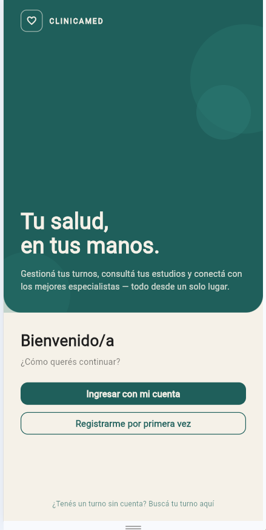
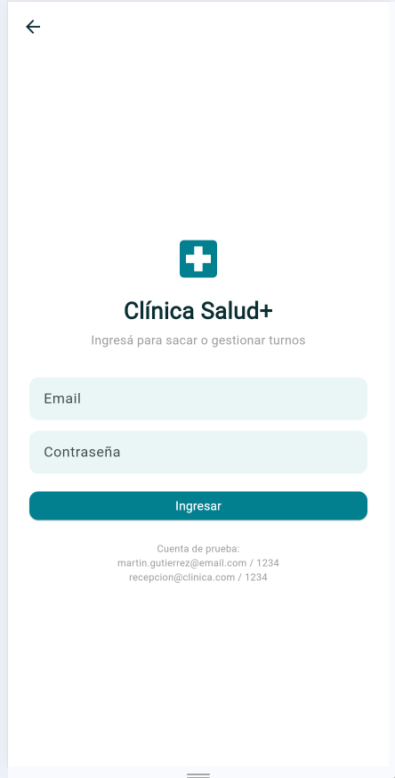
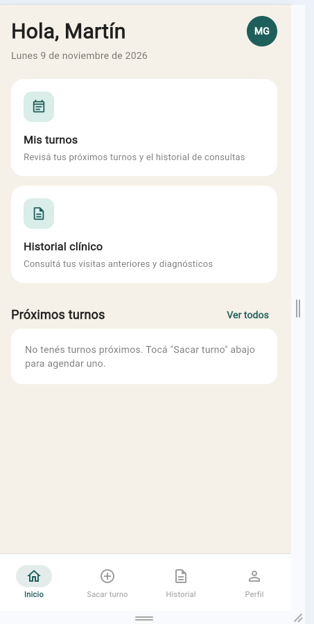
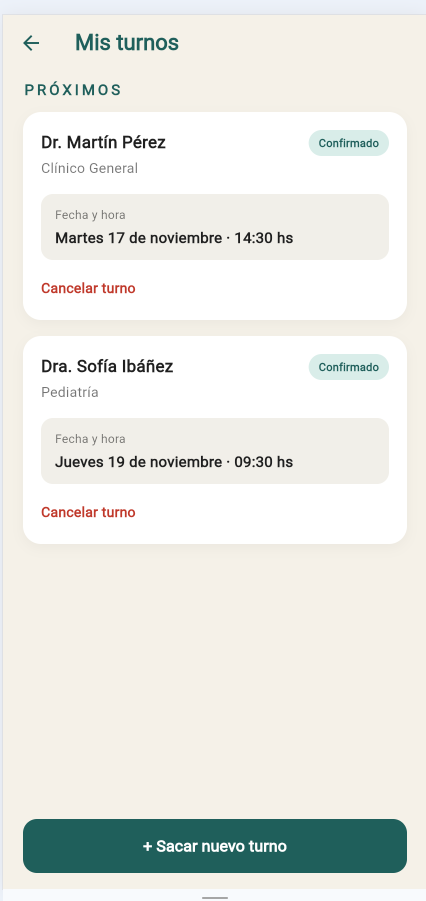
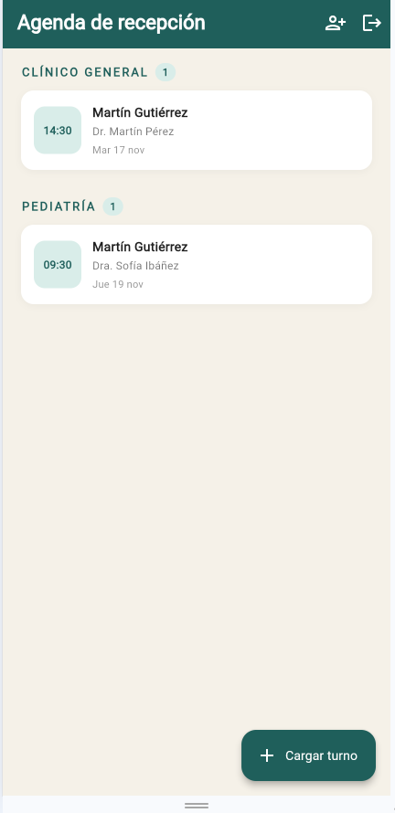
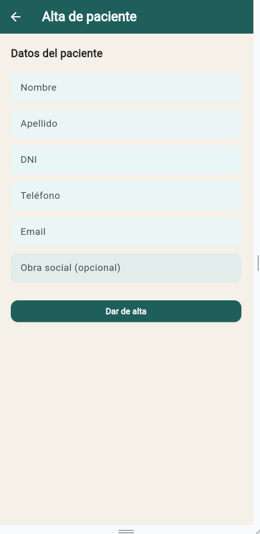

#  Clínica Turnos - App Flutter

##  1. Explicación del Proyecto

**Descripción de la idea:**
Clínica Turnos es una aplicación móvil multiplataforma desarrollada en Flutter que resuelve la gestión de turnos médicos de una clínica, dividiendo la experiencia en dos perfiles de usuario.

**Público Objetivo:**
- **Pacientes:** Personas que necesitan agendar consultas médicas de forma rápida, consultar su historial y gestionar su perfil sin tener que llamar por teléfono.
- **Personal de Recepción:** Administrativos que necesitan una agenda clara y diaria para gestionar los turnos de la clínica y registrar nuevos pacientes presenciales.

**Diseño UX/UI:**
El diseño visual (prototipado previamente en Figma) se basó en una paleta de colores que transmite confianza y profesionalismo: tonos verdes (`#1F5F5B`, `#D9EDE9`) combinados con un fondo crema (`#F5F1E8`). Se utilizaron tipografías tipo *serif* en los títulos para darle un tono institucional, y una barra de navegación inferior (Bottom Navigation Bar) similar a la de Instagram para el flujo del paciente, facilitando el acceso rápido a las acciones principales.

**Lógica de las Funcionalidades (Arquitectura):**
El proyecto fue desarrollado aplicando los principios de **Alta Cohesión** y **Bajo Acoplamiento**, bajo el paradigma de la UI Declarativa (**UI = f(Estado)**).
- **Gestión de Estado:** Se utilizó el paquete `provider` para manejar la lógica (AuthProvider y TurnosProvider).
- **Capa de Datos:** Se implementó un Repositorio (`turnos_repository.dart`) y datos simulados (`mock_data.dart`) para simular el backend. Las pantallas no saben de dónde vienen los datos, solo los consumen.
- **Modelos:** Las entidades (`Usuario`, `Turno`, `Especialista`) cuentan con métodos `toMap()` y `fromObject()`, preparados para una futura migración a una base de datos SQLite o Firebase sin tocar la interfaz visual.
- **Funcionalidades clave:** Validación de formularios, filtrado dinámico de especialistas según el día que atienden, y un calendario interactivo para agendar turnos en cualquier fecha del año.

---

## 📸 2. Evidencia de Ejecución

*(A continuación se presentan capturas de la aplicación corriendo en el emulador/dispositivo real, evidenciando la UI terminada).*

### Onboarding y Login
*Pantalla de bienvenida con el diseño institucional.*

### Flujo del Paciente
*Home del paciente con barra de navegación inferior, y pantalla de "Mis turnos" con el estado dinámico.*

### Flujo de Recepción
*Agenda diaria agrupada por especialidad y formulario de carga de turno con selector de fecha.*

---

## 👥 Integrantes
- Quiroga Juan
- Funez Emiliano
- Ortubia Agustin
- Maximo Gino

## 🛠️ Tecnologías Utilizadas
- **Flutter** (Framework UI)
- **Dart** (Lenguaje)

